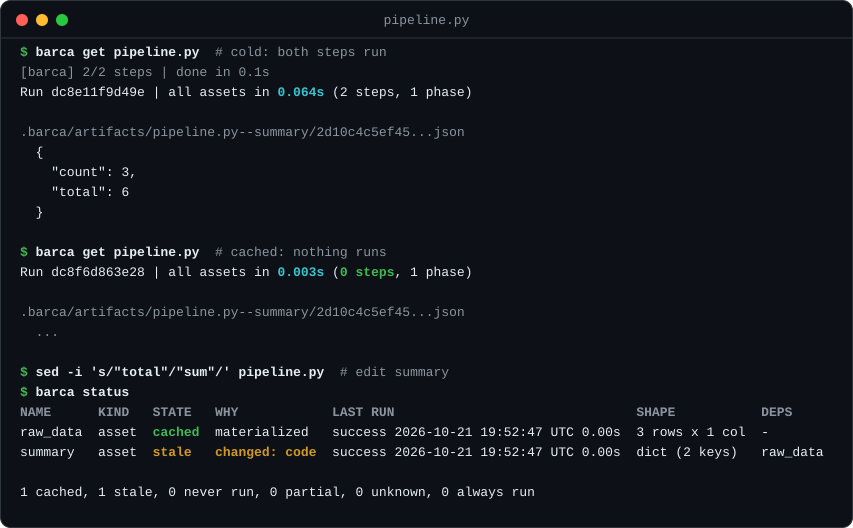
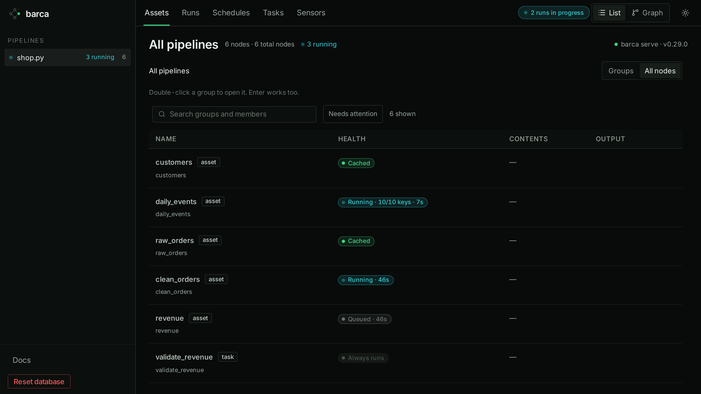

<h1 align="center">barca</h1>

<p align="center"><strong>Run Python tasks. Cache assets. Recompute only the partitions that changed.<br />
Start locally; add one server to manage runs across machines.</strong></p>

<p align="center">
  <a href="https://barca.sh">Docs</a> ·
  <a href="https://barca.sh/guide/">Guide</a> ·
  <a href="CHANGELOG.md">Changelog</a> ·
  <a href="https://barca.sh/contributing/development/">Contributing</a>
</p>

<p align="center">
  <a href="https://pypi.org/project/barca/"></a>
  <a href="https://pypi.org/project/barca/"></a>
  <a href="https://github.com/barca-orc/barca/commits/main"></a>
  <a href="https://barca.sh"></a>
  <a href="CHANGELOG.md"></a>
  <a href="LICENSE"></a>
</p>

> **Status: pre-1.0.** A breaking change to the CLI ships in a minor release with a "Breaking"
> line in the [changelog](CHANGELOG.md).

Barca runs Python functions and keeps their results and run history together. Use `@asset`
for a cached result, `@task` for an action that runs every time, and partitions for work
that should be cached separately by customer, date or another key. Declare dependencies
with `inputs={"parameter": upstream_function}`.

| You want to | Start with |
|---|---|
| Get an asset and reuse unchanged results | `barca get summary` |
| Run a task and reuse its cached inputs | `barca run publish` |
| Refresh a partition set and publish the complete result | `barca get final --refresh 'source[account=A],source[account=C]'` |
| Query cached results from Python | `barca.sql("select * from summary")` |
| Get one partition | `barca get report --partition customer=acme` |
| Manage runs on one server | `barca serve`, then `barca get summary --server http://host:8274` |

Local use needs no server or configuration. A server adds a shared run history, schedules
and a web UI. [Getting Started](https://barca.sh/getting-started/) covers each path.

<p align="center">
  
</p>

## Why barca

- **Discovers dependencies from source.** The graph comes from parsing Python. Computed
  partition keys and batch groups can import your module to resolve their values.
- **One install, no server.** `uv add barca` brings the binary, the decorators and a Python API;
  the state is one directory, `.barca/`.
- **Recomputes only what changed.** An asset runs again when its code, the project code it
  calls, or its inputs change; everything else comes from the cache.
- **Milliseconds of overhead.** A one-asset pipeline runs in 32 ms from process start to exit
  (barca 0.39.4, measured 2026-11-04, median of 20 runs). Through `benchmarks/trivial/bench.sh`,
  whose shell wrapper adds about 10 ms, it took 42 to 43 ms against 0.85 to 1.06 s for Dagster
  and 5.0 to 5.2 s for Prefect in the same runs
  ([comparison](https://barca.sh/comparisons/framework-comparison/#run-times-nothing-cached)).

## Install

```bash
uv add barca          # or: pip install barca
```

Python 3.12 or later. The wheel contains the `barca` binary, the decorators and a Python API;
wheels are published for macOS on Apple Silicon and for Linux on x86-64 and arm64, glibc and
musl. Barca runs your steps with the Python of the environment it is installed in, or `python3`
on `PATH`.

Optional extras: `barca[parquet]` (pyarrow, for DataFrames), `barca[sql]` (DuckDB, for
`barca sql`), `barca[datadog]`, and `barca[s3]`, `barca[gcs]`, `barca[azure]` or
`barca[remote]` for a remote store.

## Example

```python
# pipeline.py
from barca import asset


@asset()
def raw_data() -> list[dict]:
    return [{"x": 1}, {"x": 2}, {"x": 3}]


@asset(inputs={"data": raw_data})
def summary(data: list[dict]) -> dict:
    return {"count": len(data), "total": sum(d["x"] for d in data)}
```

```
$ barca get pipeline.py
[barca] 2/2 steps | done in 0.1s
Run dc8e11f9d49e | all assets in 0.064s (2 steps, 1 phase)

.barca/artifacts/pipeline.py--summary/2d10c4c5ef45...json
  {
    "count": 3,
    "total": 6
  }

$ barca get pipeline.py
Run dc8f6d863e28 | all assets in 0.003s (0 steps, 1 phase)
...
```

`get` prints the path of each result, with a preview of a small json value in a terminal. The
second run executes 0 steps: both results come from the cache.

Change `summary` (say, `"total"` becomes `"sum"`) and ask what is stale. `status` runs nothing:

```
$ barca status
NAME      KIND   STATE   WHY            LAST RUN                               SHAPE           DEPS
raw_data  asset  cached  materialized   success 2026-10-21 19:52:47 UTC 0.00s  3 rows x 1 col  -
summary   asset  stale   changed: code  success 2026-10-21 19:52:47 UTC 0.00s  dict (2 keys)   raw_data

1 cached, 1 stale, 0 never run, 0 partial, 0 unknown, 0 always run

$ barca get summary
[barca] 1/2 steps | done in 0.0s
Run dc8c75a5f03a | got 'summary' in 0.034s (1 step, 1 phase)
...
```

Only `summary` runs again; `raw_data` comes from the cache (in a partitioned chain, only the
keys whose inputs changed run: `barca docs partitions`). The summary line adds `unsynced` and
`blocked` counts when they are not zero; the JSON `summary` always has all eight states.
To recompute by hand, name the
assets: `barca get summary --refresh raw_data` (and everything downstream of it), or
`--refresh-all`. Do not delete files under `.barca/` to force a recompute.

Refresh a partition set while keeping complete publication with
`barca get final pipeline.py --refresh 'source[account=A],source[account=C]'`.
Fresh siblings stay cached. See `barca docs cache`.

An asset that reads a file, a bucket or a table in its own body has the same code and inputs
on every run, so it is served from cache even after the data changes. Data from outside comes
in through a `@sensor`, which runs every time and returns something identifying the current
version; the assets that take it as an input re-run only when that value changes:

```python
import hashlib
from pathlib import Path

from barca import asset, sensor


@sensor()
def orders_version() -> str:
    return hashlib.md5(Path("orders.csv").read_bytes()).hexdigest()


@asset(inputs={"version": orders_version})
def orders(version: str) -> list:
    return Path("orders.csv").read_text().splitlines()[1:]
```

More: `barca docs cache` ("External data that changes in place"), which also lists what the
run hash does not see.

`barca serve` runs the same files on cron schedules, with an HTTP API and a web UI that shows
what is cached, running and queued:

<p align="center">
  
</p>

From Python, `barca.get("summary")` returns the value, and the decorators return the function
unchanged, so steps can be called and unit tested as ordinary Python.

## Commands

The target comes first, then files or directories. Both are optional: with no files, barca
reads every `.py` file under the project root that imports barca (`barca docs discovery`).
`get` is for assets and uses the cache; `run` is for tasks, which always run, and their
upstream assets come from the cache. Use `barca <command> --help` for concise usage, `barca <command> --examples` for the full
runnable example collection, and `barca docs <topic>` for detailed behavior.

<!-- BEGIN GENERATED commands -->
| Command | What it does |
|---|---|
| `barca tokens bootstrap` | Print a one-use 15-minute bootstrap code; replaces any unconsumed grant (experimental) |
| `barca get [<ARGS>...]` | Get assets; reuse unchanged results and print their artifact paths |
| `barca run <ARGS>...` | Run a task and its dependencies; the task runs every time |
| `barca plan [<FILES>...]` | Parse source files and emit the execution plan as JSON (experimental) |
| `barca doctor [<FILES>...]` | Diagnose project prerequisites without running pipeline steps (experimental) |
| `barca logs [<RUN_ID>]` | Read a run's recorded step output (stdout and stderr), without progress messages |
| `barca history [<RUN_ID>]` | Show recent run history, or one run's steps and errors |
| `barca gc` | Evict cached results to keep .barca/ under its size limit (experimental) |
| `barca stats <TARGET> [<FILES>...]` | Show execution statistics for an asset |
| `barca pin [<TARGET>] [<FILES>...]` | Pin an asset to an earlier materialization, or list pins and versions (experimental) |
| `barca unpin <TARGET> [<FILES>...]` | Remove an asset's pin; the next run decides it as before (experimental) |
| `barca serve [<FILES>...]` | Manage runs, schedules and results on a server (experimental) |
| `barca queue [<ACTION>]` | Show a barca server's run queue, or pause or resume it (experimental) |
| `barca list [<FILES>...]` | List all discovered definitions (assets, tasks, sensors) with their deps |
| `barca status [<ARGS>...]` | Show every node's cache state, last materialization and artifact shape (read-only) |
| `barca sql <QUERY> [<FILES>...]` | Query cached results with SQL (DuckDB) — each asset is a named view (experimental) |
| `barca state backups` | List the metadata backups, local and in the store, newest first |
| `barca state restore` | Put a metadata backup in place of the local database (the current one is kept aside) |
| `barca state reset` | Start the metadata database over: move it aside and create an empty one (experimental) |
| `barca docs [<TOPIC>]` | Show the built-in manual: concepts, output formats, examples, agent conventions |
| `barca version` | Print version information |
<!-- END GENERATED commands -->

The table is generated from the CLI definition (`cargo test -p barca`); a command's row says
`(experimental)` when it may still change before 1.0 (`barca docs contract`). `barca state`
has `backups`, `restore` and `reset`; `barca queue` takes `pause` or `resume`.

Common flags on `get` and `run`: `--refresh a,b`, `--no-cascade`, `--refresh-all`,
`--batch all` / `--batch 1000` / `--batch scored=none` (override calls of nodes declaring `batch=`),
`--dry-run`, `--env <name>` (a separate cache and history), `--partition key=value` (only those
keys, across the whole run; also on `barca plan`).

**Scripts and AI agents.** Results go to stdout: a table or summary in a terminal, JSON when
piped or captured (`--json` and `--pretty` override). Progress and errors go to stderr; in JSON
mode an error is one JSON line with `error`, `code`, `kind` and `remediation`. The exit codes
(0, 1, 2, 3, 130) and their meanings are the generated table in
[the CLI contract](https://barca.sh/reference/cli-contract/#exit-codes) (`barca docs contract`).
An agent should load [`SKILL.md`](SKILL.md), also printed by `barca docs skill`.

## More

`barca docs` lists the manual's topics and `barca docs <topic>` prints one; start with
`overview`. [GLOSSARY.md](GLOSSARY.md) defines the words the CLI uses (`cached`, `stale`,
`unsynced`, run hash, ledger, store, ...) and the specifications' vocabulary. The site, [barca.sh](https://barca.sh), has the same material plus a guide and
patterns.

| Topic | Manual | Site |
|---|---|---|
| What is cached, the run hash, artifacts, environments, disk use | `barca docs cache` | [Guide](https://barca.sh/guide/) |
| Decorators, inputs, freshness, retries | `barca docs assets`, `barca docs tasks` | [Decorators API](https://barca.sh/reference/api/decorators/) |
| Output formats and large inputs (parquet, CSV, lazy DuckDB and polars) | `barca docs types`, `barca docs big-inputs` | [Guide: large inputs](https://barca.sh/guide/#6-large-inputs) |
| DuckDB 1.x and 2.x: what a pipeline changes for duckdb 2 | `barca docs duckdb` | [DuckDB Versions](https://barca.sh/reference/duckdb/) |
| Partitions: fan-out over keys, fan-in with `collect` | `barca docs partitions` | [Guide: partitions](https://barca.sh/guide/#7-partitions) |
| Schedules, `barca serve` and its HTTP API | `barca docs scheduling` | [Scheduling](https://barca.sh/scheduling/), [Deploying](https://barca.sh/deploying/) |
| Server mode: one server as the team's ledger | `barca docs server-mode` | [Share with a team](https://barca.sh/team-server/), [Server mode](https://barca.sh/reference/server-mode/) |
| A remote store (S3, GCS, Azure): this machine's backup and read-through cache | `barca docs remote` | [Remote storage](https://barca.sh/reference/remote-storage/) |
| Datadog traces, Slack notifications, JSON logs | `barca docs telemetry` | [Telemetry](https://barca.sh/reference/telemetry/) |
| Inspecting results: status, logs, sql | `barca docs status`, `barca docs logs`, `barca docs sql` | [SQL](https://barca.sh/reference/sql/) |
| Scripts and AI agents | `barca docs skill`, `barca docs agents` | [Agent skill](https://barca.sh/reference/agent-skill/) |
| The CLI contract: commands, flags, JSON schemas, exit codes, stability | `barca docs contract` | [CLI contract](https://barca.sh/reference/cli-contract/) |

## Development

```bash
git clone https://github.com/barca-orc/barca.git
cd barca
uv venv
source .venv/bin/activate
uv pip install maturin
maturin develop --uv --profile fast --extras test   # builds the binary and installs it into .venv; --release is what wheels ship
cargo test
scripts/check-fast.sh                               # CI's always-on gates, before pushing
```

Work in a worktree (`scripts/new-worktree.sh <slug>`), as [AGENTS.md](AGENTS.md) describes; see
[Architecture](https://barca.sh/architecture/) and
[Contributing](https://barca.sh/contributing/development/). `benchmarks/` holds the same
pipelines written for barca, Dagster, Prefect and Airflow;
[`benchmarks/RESULTS.md`](benchmarks/RESULTS.md) records measurements with their date and
machine.

## License

[MIT](./LICENSE)
