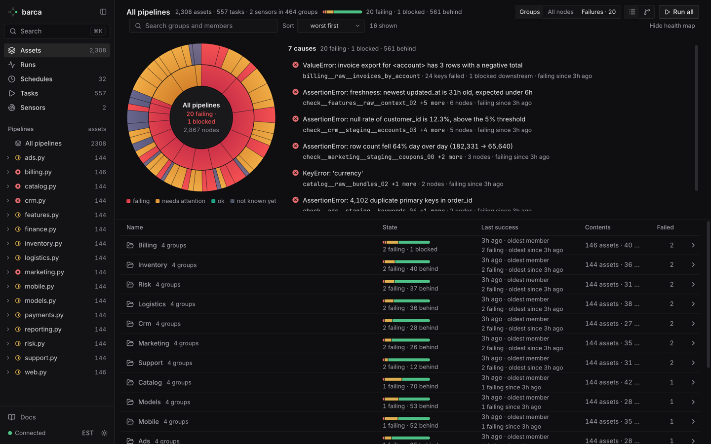
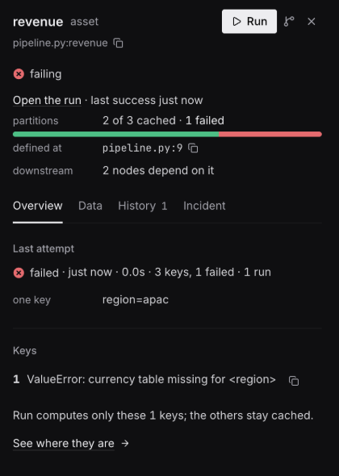

`barca serve` serves a web UI at its address: `/` redirects to `/ui/`. It shows the same
project, history and cache as the CLI, and its buttons start the same runs as `barca get` and
`barca run` on the server. A `--read-only` server says so once, in a line across the top of every
page, and shows no buttons that would change anything.

## Health: what is wrong, and where

The Assets page opens on the health of what is open (the project, a group or a file): a map of it
beside its causes, then its groups and nodes, worst first.

*The map's slices are sized by how much is wrong under them and coloured by the worst health inside: red failing, yellow needs attention, green ok; the causes list groups 20 failures into 7 errors.*

- **The map** draws the open scope at its centre and its groups (then their groups or nodes) in
  two rings. A slice's size is how much is wrong under it: failed keys of a partitioned asset,
  otherwise nodes; a scope with nothing wrong keeps a thin slice. Its colour is the worst health
  inside, in three: red is failing, yellow needs attention (blocked, suspect data or behind),
  green is ok, and grey is what barca cannot judge yet (waiting, never run). Members too thin to
  draw one by one are one `N smaller` slice. Point at a slice and the centre names it, with its
  path, health and size; click it to open it (the whole page follows), the centre to go up; hide
  the map with **Hide health map**.
- **Causes** list what is wrong once per cause, biggest first: failures that share an error
  (ignoring its numbers) are one entry, with the keys that failed and how many nodes they keep
  from running; then output that looks wrong; then what is behind.

Every count the page shows for a scope (its header, a group's row and panel, a group's card on
the graph, the map) counts the same health per node, so they agree. Each node has one health:

| Health | What it means |
|---|---|
| `failing` | Its own last attempt failed: a root cause |
| `blocked` | A failing node upstream keeps it from running; it names that node |
| `suspect data` | Its last run succeeded, but the output looks wrong: it wrote 0 rows (a partitioned asset: some keys did), its row count changed by more than half, or it is older than an input |
| `behind` | Stale, partly computed or out of sync, or a schedule that missed its slot |
| `waiting` | barca cannot decide yet: a cutoff or sensor upstream has not reported. Expected |
| `never run` | Nothing recorded |
| `ok` | Up to date, or a task or sensor whose last run succeeded |

The data signals behind `suspect data` come from row counts barca records for every tabular
result ([Row counts](/reference/cli/status-fields/#row-counts)); a node's panel lists them under its state.

## Finding your way

The sidebar holds Search, then **Assets**, **Runs**, **Schedules**, **Tasks** and **Sensors**,
then the pipelines (one per source file), then Docs, the connection, the time zone and the
theme. Drag its edge to widen it (or use the arrow keys on the edge; double-click resets it).
**Ctrl/Cmd-K** opens a command palette that finds assets and partition keys, each with its state,
failing first, and runs what is open. Filters and the open item are in the address, so a link
reopens the same view. Every time is relative (`3m ago`, `in 5m`), the exact time on hover.

The Schedules page says when a schedule missed its slot (`late by 12m`) instead of counting down
to its next one.

## States

A node also shows its own state in plain words, with an icon beside its colour: the precise
kind of its health (`stale` and `partial` are both `behind`). The UI and the CLI use different
words for some of them (the UI says `fresh` where `barca status` says `cached`); this is how they
map. The full list of states and their reasons is in
[barca status: Cache state](/reference/cli/status/#cache-state).

| Web UI | What it means | `barca status` |
|---|---|---|
| `fresh` | Its result matches the current code and inputs; a run serves it from cache | `cached` |
| `stale` | It ran before, but its code or an input changed (or its file is gone), so the next run computes it again | `stale` |
| `never run` | No successful result is recorded yet | `never_run` |
| `waiting` | barca cannot say yet: a cutoff or sensor upstream has not decided | `unknown` |
| `failing` | Its last attempt failed, shown with "last good 3h ago" or "never succeeded" | `stale` with reason `failed` |
| `blocked` | A failing node upstream keeps it from running (also through `waiting` nodes); the row links to that failure | `blocked` for partition keys; otherwise worked out in the UI from the graph |
| `succeeded` | A task or sensor whose last run succeeded (`always runs` is shown as a property) | `always_runs` |

A pinned asset shows `pinned` beside its version ([Pinning and Rollback](/reference/cli/pin/)).

## Runs: why they ran, what failed, and running it again

The Runs page lists the queue (running runs first, then the waiting ones with how long they have
waited; it folds to one line) above the run history. While runs wait, the sidebar shows the queue
on every page: how many run and wait, and the oldest wait.

A run's panel opens with what failed: each failed step, its error and where it raised. Its **Run
overview** says why the run executed what it did, from the reasons barca records when it plans
(never run, code or an input changed and which, new partition keys, a forced refresh, a retry of
a failure), who asked for it (the API token's name, and the reason a caller gave), how its
attempts relate to its steps, and why it was cancelled when it was (a run that never started
names the run it waited behind). While a run is live it shows its progress in steps and keys,
what executes now, by group, and an estimate of what is left. Logs and steps render only what is
in view, so a run of tens of thousands of steps opens at once; a node's keys are one row until
opened.

![A failed run's panel: the failed step revenue[region=apac] with its ValueError and the line it raised at, Re-run failed and Re-run all buttons, and the run's trigger, target, timing and step counts](../../assets/web-ui/run-details.png)
*A failed run: the failed key, its error and the line it raised at, with **Re-run failed** first.*

Its actions:

- **Re-run failed**: the failed steps and everything downstream of them, the same target
  again, so the steps that succeeded are served from cache.
- **Re-run all**: the same target with every step recomputed (`--refresh-all`).
- **Retry** on one failed step or partition key.
- **Copy incident summary**: markdown with the run's link, target, trigger, timing and failed
  steps.
- **Cancel run**, for a queued or running run, with a confirmation. A cancelled run does not claim
  that steps it never recorded were cached or succeeded.

The logs filter by step, by text, and to errors only.

## Assets, keys and incidents

An asset's panel has tabs: **Overview**, **Data** (a preview of its result), **History** and
**Incident**.

*A partitioned asset with one failed key: **Run** computes only that key; the other two stay cached.*

- **Incident** holds the controls for an incident: pausing and resuming the asset, as
  `barca pause` and `barca resume` do, and resuming a paused pipeline
  ([Pausing Assets](/reference/cli/pause/)). Uploading replacement data and holding an earlier
  version are on the asset panel and in the key explorer, as `barca pin` does
  ([Pinning and Rollback](/reference/cli/pin/)).
- For a partitioned asset, the **key explorer** shows every key at once, coloured by state, with
  each problem as one line (an error and the keys it hit, blocked keys, stale and never-run
  keys) and a Run button for the keys that are not fresh. See
  [Exploring keys in the web UI](/reference/partitions/#exploring-keys-in-the-web-ui).

## Connecting to a server with tokens

When the server runs with `--auth token`, the UI asks for a bootstrap code or an API token on its
Connect screen, and **API tokens** in the sidebar creates and revokes named tokens. The steps are
in [Authentication and Tokens](/auth/).
