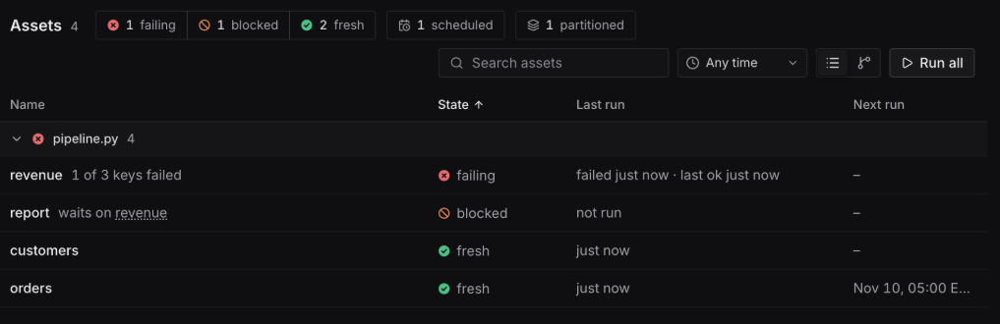
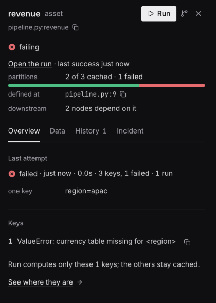

`barca serve` serves a web UI at its address: `/` redirects to `/ui/`. It shows the same
project, history and cache as the CLI, and its buttons start the same runs as `barca get` and
`barca run` on the server. A `--read-only` server shows a `read-only` tag and disables them.

*The Assets view: worst first. `revenue` failed for one of its three keys, so `report`, which reads it, is blocked.*

## Finding your way

The sidebar holds Search, then **Assets**, **Runs**, **Schedules**, **Tasks** and **Sensors**,
then the pipelines (one per source file), then Docs, the connection, the time zone and the
theme. **Ctrl/Cmd-K** opens a command palette that finds assets and partition keys and runs
what is open. Filters and the open item are in the address, so a link reopens the same view.

## States

Each node shows one state in plain words, with an icon beside its colour. The UI and the CLI use
different words for some of them (the UI says `fresh` where `barca status` says `cached`); this is
how they map:

| Web UI | `barca status` |
|---|---|
| `fresh` | `cached` |
| `stale` | `stale` |
| `never run` | `never_run` |
| `failing`: the last attempt failed, with "last good 3h ago" or "never succeeded" | `stale` with reason `failed` |
| `blocked`: a failing node upstream keeps it from running, with a link to that failure | `blocked` for partition keys; otherwise derived in the UI from the graph |

A pinned asset shows `pinned` beside its version ([Pinning and Rollback](/reference/cli/pin/)).

## Runs: what failed, and running it again

A run's panel opens with what failed: each failed step, its error and where it raised.

![A failed run's panel: the failed step revenue[region=apac] with its ValueError and the line it raised at, Re-run failed and Re-run all buttons, and the run's trigger, target, timing and step counts](../../assets/web-ui/run-details.png)
*A failed run: the failed key, its error and the line it raised at, with **Re-run failed** first.*

Its actions:

- **Re-run failed**: the failed steps and everything downstream of them, the same target
  again, so the steps that succeeded are served from cache.
- **Re-run all**: the same target with every step recomputed (`--refresh-all`).
- **Retry** on one failed step or partition key.
- **Copy incident summary**: markdown with the run's link, target, trigger, timing and failed
  steps.
- **Cancel run**, for a queued or running run, with a confirmation. A cancelled run does not claim
  that steps it never recorded were cached or succeeded.

The logs filter by step, by text, and to errors only.

## Assets, keys and incidents

An asset's panel has tabs: **Overview**, **Data** (a preview of its result), **History** and
**Incident**.

*A partitioned asset with one failed key: **Run** computes only that key; the other two stay cached.*

- **Incident** holds the controls for an incident: pausing and resuming the asset, as
  `barca pause` and `barca resume` do, and resuming a paused pipeline
  ([Pausing Assets](/reference/cli/pause/)). Uploading replacement data and holding an earlier
  version are on the asset panel and in the key explorer, as `barca pin` does
  ([Pinning and Rollback](/reference/cli/pin/)).
- For a partitioned asset, the **key explorer** shows every key at once, coloured by state, with
  each problem as one line (an error and the keys it hit, blocked keys, stale and never-run
  keys) and a Run button for the keys that are not fresh. See
  [Exploring keys in the web UI](/reference/partitions/#exploring-keys-in-the-web-ui).

## Connecting to a server with tokens

When the server runs with `--auth token`, the UI asks for a bootstrap code or an API token on its
Connect screen, and **API tokens** in the sidebar creates and revokes named tokens. The steps are
in [Authentication and Tokens](/auth/).
